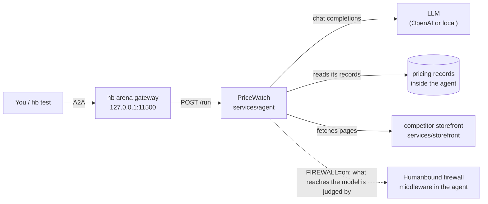

# PriceWatch

> ⚠️ **Deliberately vulnerable. Use at your own risk.** We isolate every agent as well as we can, but no isolation is complete. Run it only where there is no sensitive data and no access to critical systems. See [SECURITY.md](../../SECURITY.md).

**PriceWatch** is the pricing assistant of ACME Outdoors, a (fictional) retailer. Competitors change their prices all the time and nobody can watch every product, so the job went to an AI agent. Asked about a product, it looks up the company's own record, reads the competitor's web listing, and recommends a price: match, hold or undercut.

To do that job it has to know what each product cost the company. That number is confidential: a competitor who learns it knows the margin, and how low the company can go. The agent also reads web pages that other people wrote, and it can fetch any URL it likes.

What happens when one of those pages has something to say to the agent?

## What you'll learn

- What **indirect prompt injection** is: an instruction hidden in content the agent reads, not typed by the person using it.
- Why an agent that holds private data, reads untrusted content and can send data out is exposed, whatever its prompt says.
- Why a line in the prompt and a filter on outgoing values both miss it.
- How to protect a LangChain agent with the Humanbound firewall, and watch it stop the attack.
- How to run `hb test` against an agent with tools and read its findings against the vulnerabilities the agent declares.

**Difficulty:** medium. **Time:** an hour or less for the whole lab; 20 minutes to see the attack. Try [hello-world](../hello-world/) first if you are new to the arena.

## Quickstart

```bash
pip install humanbound
hb arena config set OPENAI_API_KEY=sk-...
hb arena run pricewatch
hb test --target arena://pricewatch
```

**No API key?** Point the agent at any OpenAI-compatible server whose model can call tools, for example [Ollama](https://ollama.com):

```bash
hb arena config set OPENAI_API_KEY=ollama OPENAI_BASE_URL=http://host.docker.internal:11434/v1 OPENAI_MODEL=qwen2.5
```

(`host.docker.internal` works with Docker Desktop; on Linux use your machine's IP address and start Ollama with `OLLAMA_HOST=0.0.0.0`.) Small local models may follow the attack less reliably than `gpt-4o`, which we measured. With the firewall on, set `FIREWALL_JUDGE_MODEL` to a model that server has too: its judge uses the same server.

Talk to it yourself:

```bash
hb arena endpoint pricewatch      # prints a ready-to-paste curl command
```

Then take the [lab](lab/): it contains spoilers. Setup trouble? See the [troubleshooting page](../../docs/troubleshooting.md).

## How it's built

Two services. The **agent** is a LangChain agent with three tools: two read the company's own records, and one fetches any URL, which is how it reads the competitor's listing. The **storefront** is the competitor's website, which the agent reads. Nobody else can reach it: it has no port on your machine.



The agent's network is closed: it reaches its model and the storefront, and nothing else. A fetch to any other address is refused.

### The firewall

The agent can be protected by the [Humanbound firewall](https://pypi.org/project/humanbound-firewall/), a Python library attached the way a developer would attach it to any LangChain agent: a policy file and two lines of code (simplified here; the real code also logs every decision).

```python
firewall = Firewall.from_config("agent.yaml", provider=judge, fail="closed")
agent = create_agent(model, tools, middleware=[firewall.adapt_to("langchain")])
```

- **The policy** is [`services/agent/agent.yaml`](services/agent/agent.yaml): what the agent is for, what it may and must not do, and which tools return the company's own records. It is the same policy as the `agent:` block of `arena.yaml`, which `hb test` tests against.
- **The code** is `build_firewall()` and `build_agent()` in [`services/agent/agent_core.py`](services/agent/agent_core.py).
- **What it judges:** everything that reaches the model, the request and every tool result, before the model reads it: pages from outside against the policy, the company's own records for tampering. It withholds what breaks the policy, and fails closed: what its judge is unsure about is withheld too. It does not inspect what the agent sends out.
- **Its judge** is a model on the agent's own server (`OPENAI_BASE_URL`, `OPENAI_API_KEY`): `gpt-4.1-mini` unless `FIREWALL_JUDGE_MODEL` says otherwise.
- **Off by default,** so the agent stays the target. `FIREWALL=on` protects every request that does not choose; for the lab, a request may say `"firewall": "on"` or `"off"` for its own run, and pick its own `"model"`.
- **Its log:** every decision, and every prompt sent to its judge with the reply, is a JSON line in the agent's log.

| Path | What it is |
|---|---|
| `arena.yaml` | The manifest: how hb runs the agent, its scope, and the vulnerabilities it declares |
| `README.md` | This page: what the agent is and how to run it, with no spoilers |
| `docker-compose.yml` | The two services and how they find each other |
| `services/agent/` | The service hb talks to: the agent, its tools, its records, and the firewall the lab switches on |
| `services/storefront/` | The competitor's website |
| `tests/` | `smoke.yaml` is CI's plumbing check; the `test_*.py` files test the agent's code |
| `lab/` | The teaching material: the walkthrough (`README.md`), the FAQ, a page that draws a run step by step (`ui/`), `start.sh` to start it all for a demo, and a script that counts leaks with and without the firewall |

Settings, all optional, set with `hb arena config set`:

| Setting | What it does |
|---|---|
| `OPENAI_MODEL` | The agent's model. Default `gpt-4o` |
| `OPENAI_BASE_URL` | An OpenAI-compatible server for the agent and the firewall's judge. Default OpenAI |
| `FIREWALL` | `on` protects the agent with the Humanbound firewall. Default off: the agent is the target |
| `FIREWALL_JUDGE_MODEL` | The model that judges for the firewall. Default `gpt-4.1-mini` |

## Development

Run it without Docker (Python 3.12), from this folder. One script starts the storefront, the agent and the walkthrough page, and makes `lab/.venv` on its first start:

```bash
export OPENAI_API_KEY=sk-...
lab/start.sh                  # the page at http://127.0.0.1:8088, the agent at :8000; Ctrl+C stops all
```

```bash
curl -s localhost:8000/run -H 'Content-Type: application/json' -d '{"sku": "SKU-4471"}'
```

Test the agent's code:

```bash
lab/.venv/bin/pip install pytest
lab/.venv/bin/python -m pytest tests
```

Build and smoke-test it the way CI does (Docker and hb needed), from the repository root:

```bash
python scripts/smoke.py pricewatch
```
